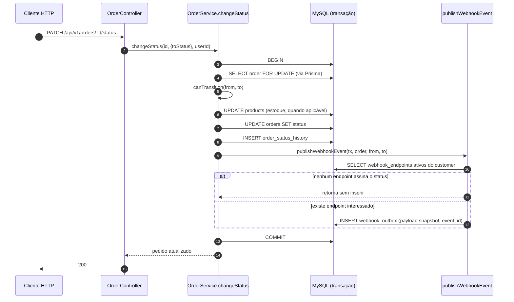
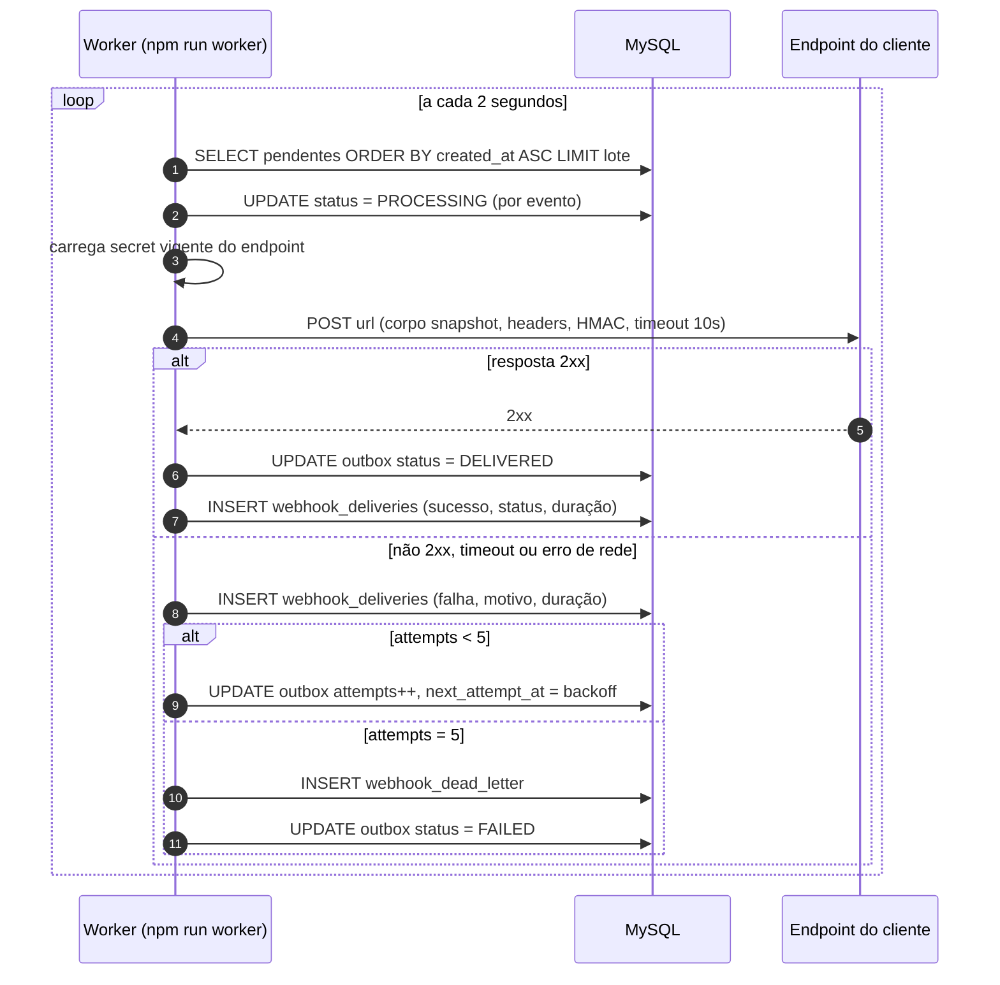

# FDD - Sistema de Webhooks de Notificação de Pedidos

| Campo | Valor |
| --- | --- |
| Feature | Sistema de Webhooks de Notificação de Pedidos |
| Sistema | Order Management System (Node.js + TypeScript + Express + Prisma + MySQL) |
| Autor | Helder Puia |
| Versão | 1.0 |
| Data | 2026-11-07 |
| Documentos relacionados | [PRD](PRD.md), [RFC](RFC.md), [ADRs](adrs/README.md) |

## 1. Contexto e motivação técnica

A aplicação não possui mecanismo de notificação externa. Clientes B2B descobrem mudança de status fazendo polling em `GET /api/v1/orders`, o que torna a integração deles lenta e cara ([09:00] Marcos). A feature introduz entrega outbound de eventos de mudança de status.

O ponto de acoplamento é `OrderService.changeStatus` (`src/modules/orders/order.service.ts`). Hoje esse método executa, em uma única transação Prisma: busca do pedido, validação da transição com `canTransition` (`src/modules/orders/order.status.ts`), débito ou reposição de estoque, `UPDATE` em `orders`, `INSERT` em `order_status_history` e releitura do pedido com relações. Qualquer notificação precisa ser registrada dentro dessa mesma transação, senão a garantia de consistência se perde ([09:41] Diego).

Restrições técnicas que moldam o desenho:

- A transação de status já é pesada e não pode passar a depender de rede externa ([09:04] Bruno).
- O banco é MySQL 8 via Prisma 5.22, sem broker de mensagens ([09:09] Diego).
- O cliente aceita latência abaixo de 10 segundos como "tempo real" ([09:02] Marcos).
- O worker precisa rodar em processo separado ([09:11] Diego).
- O time quer reuso máximo dos padrões existentes, sem biblioteca nova ([09:29] Bruno, [09:30] Larissa).

## 2. Objetivos técnicos

| # | Objetivo | Medida ou invariante |
| --- | --- | --- |
| FDD-OT-01 | Registrar o evento na mesma transação da mudança de status | Não existe estado em que `orders.status` mudou e o evento não foi inserido; rollback remove os dois |
| FDD-OT-02 | Entregar dentro do teto de latência aceito pelo cliente | p95 do intervalo entre commit da transação e primeiro envio abaixo de 10s, com polling de 2s |
| FDD-OT-03 | Isolar a entrega do ciclo de vida da API | Worker em processo próprio, com entry-point e script separados |
| FDD-OT-04 | Respeitar assinatura e integridade no destino | Todo envio leva HMAC-SHA256 do corpo, secret por endpoint, validável pelo cliente |
| FDD-OT-05 | Não perder evento silenciosamente | Toda entrega termina como `DELIVERED` ou em `webhook_dead_letter`, nunca descartada |
| FDD-OT-06 | Ser idempotente do lado do cliente | `X-Event-Id` constante entre tentativas do mesmo evento |
| FDD-OT-07 | Filtrar o que o cliente assinou | Nenhuma linha de outbox criada para status que nenhum endpoint do customer assina |
| FDD-OT-08 | Ordenar entregas do mesmo pedido na configuração atual | Com worker único, eventos do mesmo `order_id` saem em ordem crescente de `created_at`, exceto quando há tentativa pendente para o pedido (limitação conhecida, seção 4.2) |

## 3. Escopo e exclusões

**Incluído nesta entrega**

- Quatro tabelas novas no schema Prisma: `webhook_endpoints`, `webhook_outbox`, `webhook_dead_letter`, `webhook_deliveries`.
- Função `publishWebhookEvent` chamada dentro da transação de `changeStatus`.
- Módulo `src/modules/webhooks` com controller, service, repository, routes e schemas.
- Processador `webhook.processor.ts` e entry-point `src/worker.ts` com script `npm run worker`.
- CRUD de configuração, listagem de entregas, rotação de secret e replay de DLQ.
- Assinatura HMAC-SHA256, validação de URL `https`, limite de payload de 64KB, timeout de 10s, retry com backoff e DLQ.
- Instrumentação de logs e métricas descrita na seção 8.

**Excluído nesta entrega**

- Arquivamento de linhas entregues da outbox. Fica para depois, fora do escopo desta feature ([09:08] Diego).
- Notificação por e-mail ao cliente quando o webhook falha ([09:37] Larissa).
- Rate limiting de envio por cliente. A decisão foi observar e reavaliar ([09:39] Larissa).
- Dashboard visual para o cliente. Painel é projeto separado do time de frontend ([09:40] Larissa).
- Webhooks inbound, ou seja, cliente enviando evento para a plataforma ([09:02] Marcos).
- Garantia de ordenação global entre pedidos diferentes ([09:13] Larissa).
- Bloqueio de fila por `order_id` para garantir ordem mesmo com retry pendente, alternativa registrada como questão em aberto (RFC-QA-07).
- Escala para múltiplos workers em paralelo com particionamento por `order_id` ([09:13] Diego).
- Reprocessamento automático de DLQ. O replay é manual e administrativo ([09:18] Diego).
- Alteração de qualquer arquivo de `src/`, `prisma/` ou `tests/` nesta fase de design. O entregável é documental.

## 4. Fluxos detalhados

### 4.1 Criação do evento na outbox (caminho transacional) (FDD-FLUXO-01)



Passos detalhados:

1. `changeStatus` valida a transição e executa as operações atuais, sem alteração de ordem ou de semântica.
2. Após o `INSERT` em `order_status_history` e antes da releitura do pedido, chama `publishWebhookEvent(tx, order, from, to)`.
3. `publishWebhookEvent` recebe o `tx` (Prisma `TransactionClient`), o pedido com `id`, `orderNumber`, `customerId` e `totalCents`, e os status de origem e destino.
4. Consulta `webhook_endpoints` com `customerId`, `active = true` e o status de destino presente na lista `statuses`.
5. Para cada endpoint encontrado, monta o payload snapshot (seção 5.1) com `event_id` novo em UUID v4, e insere uma linha em `webhook_outbox` com `status = PENDING`, `attempts = 0` e `nextAttemptAt = now()`.
6. Se nenhum endpoint assinar o status, não insere nada (ADR-008).
7. Se qualquer escrita falhar, a exceção sobe e a transação inteira sofre rollback, incluindo a mudança de status. Esse é o comportamento desejado: nunca status alterado sem evento ([09:40] Bruno).

Detalhe de implementação: `publishWebhookEvent` é uma função pura que recebe `tx`, e não o repositório inteiro, para não injetar dependência nova no `OrderService` ([09:41] Bruno, [09:41] Diego).

### 4.2 Processamento pelo worker (FDD-FLUXO-02)



Regras do laço:

1. Um único worker por vez nesta fase. O lote é pequeno e processado em série, o que preserva a ordem de `created_at` no caminho feliz. Isso **não** garante ordem por `order_id` quando existe retry pendente, como a limitação abaixo explica (ADR-002).
2. O worker só considera eventos com `status = PENDING` e `nextAttemptAt <= now()`, garantindo que o backoff seja respeitado sem `sleep` bloqueante por evento.
3. Antes do envio, o evento é marcado como `PROCESSING` para evitar que duas leituras concorrentes peguem o mesmo registro.
4. Se o processo morrer entre marcar `PROCESSING` e concluir, o evento precisa voltar a ser elegível. A estratégia é recuperar eventos em `PROCESSING` com `updatedAt` mais antigo que `2 x timeout` no início de cada ciclo, o que é coerente com a garantia at-least-once (ADR-005).
5. O corpo enviado é exatamente o `payload` armazenado, sem reserialização parcial. A assinatura é calculada sobre a string enviada, evitando divergência entre assinatura e corpo.
6. Erro em um evento não interrompe o lote: cada evento é processado em `try/catch` isolado, com log do erro.
7. Evento cujo webhook está inativo ou removido não é enviado: o worker o move para a DLQ com motivo `WEBHOOK_INACTIVE`, mantendo a invariante de nunca descartar evento sem registro.
8. `SIGINT` e `SIGTERM` encerram o laço após o lote corrente e desconectam o Prisma, seguindo o padrão de shutdown de `src/server.ts`.

**Limitação conhecida: ordenação por pedido não sobrevive a retry.** Se o evento A de um pedido falha e entra em backoff de 1 minuto, o evento B do mesmo pedido, criado depois, é elegível no ciclo seguinte e é entregue antes da nova tentativa de A. A ordem só é preservada no caminho sem falha. As saídas possíveis foram mapeadas e adiadas na reunião: particionar por `order_id` ou usar lock pessimista por pedido ([09:12] Diego, [09:13] Larissa). Bloquear a fila de um pedido enquanto houver tentativa pendente (head-of-line blocking por `order_id`) é a alternativa mais simples e fica registrada como questão em aberto no RFC ([RFC-QA-07](RFC.md)). Nenhum cliente pediu garantia de ordenação global, e a expectativa registrada é que cada pedido seja notificado da sua mudança ([09:14] Marcos).

### 4.3 Retry e backoff (FDD-FLUXO-03)

| Tentativa | Espera após falha | Momento acumulado aproximado |
| --- | --- | --- |
| 1 | 1 minuto | 1 min |
| 2 | 5 minutos | 6 min |
| 3 | 30 minutos | 36 min |
| 4 | 2 horas | ~2h36 |
| 5 | 12 horas | ~14h36 |

Depois da quinta falha, o evento é considerado falha permanente e vai para a DLQ. O cronograma é o decidido na reunião ([09:17] Diego, [09:17] Larissa), com total de aproximadamente 15 horas.

A política de retry trata qualquer resposta não 2xx, timeout de 10 segundos e erro de rede como falha sujeita ao mesmo cronograma. A reunião não definiu distinção entre erro permanente e transitório no lado do cliente, então o desenho não inventa essa distinção: um 404 do cliente consome tentativas igual a um 503.

### 4.4 Dead Letter Queue e replay (FDD-FLUXO-04)

1. Na quinta falha, o worker insere em `webhook_dead_letter` com `payload`, `reason`, `attempts`, `webhookId`, `customerId`, `eventId` e `failedAt`, e marca a linha da outbox como `FAILED`.
2. O cliente ou o time interno consulta o histórico pelo endpoint de entregas e identifica a falha.
3. Um usuário com role `ADMIN` chama `POST /api/v1/admin/webhooks/dead-letter/:id/replay`.
4. O serviço valida que o registro existe, que o endpoint associado está ativo, cria uma nova linha em `webhook_outbox` com o mesmo `event_id` e `status = PENDING`, e registra `replayedAt` e `replayedBy` na linha da DLQ.
5. O replay é logado com o id do usuário que executou, para auditoria ([09:36] Sofia).

O `event_id` é preservado no replay de propósito: o cliente deduplica um eventual reenvio do mesmo evento ([09:25] Diego).

## 5. Contratos públicos

Base: `/api/v1`. Todos os endpoints exigem o header `Authorization` com o JWT emitido pelo `POST /api/v1/auth/login` existente, no formato `Bearer` seguido do token. Erros seguem o envelope já usado pela aplicação, produzido por `src/middlewares/error.middleware.ts`.

```json
{
  "error": {
    "code": "WEBHOOK_NOT_FOUND",
    "message": "Webhook not found",
    "details": {}
  }
}
```

Observação de escopo importante: o `customerId` vem do corpo ou do path, nunca do JWT. O JWT identifica o usuário operador, não o cliente ([09:32] Bruno, [09:32] Larissa).

### 5.1 Payload do evento entregue ao cliente (FDD-PAYLOAD-01)

```json
{
  "event_id": "8f14e45f-ceea-4b7e-9d0f-2b3a1c7d9e01",
  "event_type": "order.status_changed",
  "timestamp": "2026-11-07T13:42:11.482Z",
  "order_id": "1c9f2ad4-6b0e-4a51-9a37-0f7c2e5b8d44",
  "order_number": "ORD-000123",
  "customer_id": "7b2d9c10-3f4a-4e88-b0d1-5c6a9e2f7b31",
  "from_status": "PAID",
  "to_status": "SHIPPED",
  "total_cents": 24990
}
```

Semântica dos campos:

| Campo | Tipo | Descrição |
| --- | --- | --- |
| `event_id` | string (uuid) | Identificador do evento, igual ao `X-Event-Id`, estável entre tentativas |
| `event_type` | string | Sempre `order.status_changed` nesta versão |
| `timestamp` | string (ISO 8601 UTC) | Momento em que o evento foi registrado na outbox |
| `order_id` | string (uuid) | Id do pedido |
| `order_number` | string | Número legível do pedido, formato `ORD-000000` |
| `customer_id` | string (uuid) | Customer dono do webhook |
| `from_status` | string | Status anterior, um valor de `OrderStatus` |
| `to_status` | string | Status novo, um valor de `OrderStatus` |
| `total_cents` | integer | Total do pedido em centavos no momento da transição |

Itens do pedido não são enviados, para manter o payload enxuto. Quem precisa do detalhe consulta `GET /api/v1/orders/:id` ([09:43] Diego).

Headers de toda entrega (FDD-HEADER-01 e FDD-HEADER-02):

| Header | Exemplo | Semântica |
| --- | --- | --- |
| `Content-Type` | `application/json` | Corpo é JSON |
| `X-Event-Id` | `8f14e45f-ceea-4b7e-9d0f-2b3a1c7d9e01` | Id único do evento, chave de deduplicação |
| `X-Signature` | `sha256=9f2c...` | HMAC-SHA256 do corpo bruto com a secret do endpoint |
| `X-Timestamp` | `2026-11-07T13:42:11.482Z` | Momento do envio, permite ao cliente detectar replay |
| `X-Webhook-Id` | `3d5a71c8-2b9e-4f60-8a1d-6e4c0f9b2a77` | Id do cadastro de webhook que originou o envio |

O valor de `X-Signature` é o HMAC-SHA256 em hexadecimal do corpo exato do request, opcionalmente prefixado com `sha256=`. O formato exato do valor não foi definido na reunião; é detalhe de contrato a ser confirmado na revisão do RFC, e o prefixo ajuda o cliente a evoluir o algoritmo no futuro. O cliente deve calcular o HMAC sobre os bytes recebidos, nunca sobre um JSON reserializado.

### 5.2 POST /api/v1/webhooks (FDD-CONTRATO-01)

Cria um cadastro de webhook. A secret é gerada pela plataforma e devolvida apenas nesta resposta ([09:31] Marcos).

Request:

```http
POST /api/v1/webhooks
Authorization: Bearer <jwt>
Content-Type: application/json

{
  "customerId": "7b2d9c10-3f4a-4e88-b0d1-5c6a9e2f7b31",
  "url": "https://integracao.atlascomercial.com.br/oms/webhooks",
  "statuses": ["SHIPPED", "DELIVERED"],
  "active": true
}
```

Response `201 Created`:

```json
{
  "id": "3d5a71c8-2b9e-4f60-8a1d-6e4c0f9b2a77",
  "customerId": "7b2d9c10-3f4a-4e88-b0d1-5c6a9e2f7b31",
  "url": "https://integracao.atlascomercial.com.br/oms/webhooks",
  "statuses": ["SHIPPED", "DELIVERED"],
  "active": true,
  "secret": "whsec_5f1c9a0d7b2e4c8f9a6d3e1b0c7f2a48",
  "createdAt": "2026-11-07T13:40:02.115Z"
}
```

Status codes: `201` criado, `400` falha de schema (`VALIDATION_ERROR`, inclusive URL que não é string de URL), `404` customer inexistente (`NOT_FOUND`, reaproveitando `NotFoundError`), `422` URL recusada pela política (`WEBHOOK_INVALID_URL`), `401` sem token.

Nota sobre a fronteira entre `400` e `422` neste contrato: a reunião tratou a exigência de `https` como "só uma validação no schema Zod" ([09:23] Sofia), que produz `400 VALIDATION_ERROR` pelo `validate` middleware. O código `WEBHOOK_INVALID_URL` foi citado como padrão de erro do módulo ([09:28] Bruno). Para não contradizer nenhum dos dois, o desenho usa `400` para forma inválida (não parseável como URL) e `422` para URL bem formada que viola política, como `http` ou host interno.

### 5.3 GET /api/v1/webhooks (FDD-CONTRATO-02)

Lista os cadastros de um customer, com paginação no padrão do projeto (`paginated` de `src/shared/http/response.ts`).

Request:

```http
GET /api/v1/webhooks?customerId=7b2d9c10-3f4a-4e88-b0d1-5c6a9e2f7b31&page=1&pageSize=20
Authorization: Bearer <jwt>
```

Response `200 OK`:

```json
{
  "data": [
    {
      "id": "3d5a71c8-2b9e-4f60-8a1d-6e4c0f9b2a77",
      "customerId": "7b2d9c10-3f4a-4e88-b0d1-5c6a9e2f7b31",
      "url": "https://integracao.atlascomercial.com.br/oms/webhooks",
      "statuses": ["SHIPPED", "DELIVERED"],
      "active": true,
      "createdAt": "2026-11-07T13:40:02.115Z",
      "updatedAt": "2026-11-07T13:40:02.115Z"
    }
  ],
  "pagination": { "page": 1, "pageSize": 20, "total": 1, "totalPages": 1 }
}
```

Status codes: `200` sucesso, `400` query inválida, `401` sem token. A secret nunca é devolvida na listagem, apenas mascarada quando necessário para suporte.

O envelope é o de `paginated()` em `src/shared/http/response.ts`, que devolve `{ data, pagination }`, e não `meta`.

### 5.4 PATCH /api/v1/webhooks/:id (FDD-CONTRATO-03)

Edita URL, lista de status assinados ou estado ativo.

Request:

```http
PATCH /api/v1/webhooks/3d5a71c8-2b9e-4f60-8a1d-6e4c0f9b2a77
Authorization: Bearer <jwt>
Content-Type: application/json

{
  "url": "https://integracao.atlascomercial.com.br/oms/v2/webhooks",
  "statuses": ["PAID", "SHIPPED", "DELIVERED", "CANCELLED"]
}
```

Response `200 OK`:

```json
{
  "id": "3d5a71c8-2b9e-4f60-8a1d-6e4c0f9b2a77",
  "customerId": "7b2d9c10-3f4a-4e88-b0d1-5c6a9e2f7b31",
  "url": "https://integracao.atlascomercial.com.br/oms/v2/webhooks",
  "statuses": ["PAID", "SHIPPED", "DELIVERED", "CANCELLED"],
  "active": true,
  "updatedAt": "2026-11-07T14:02:44.901Z"
}
```

Status codes: `200` atualizado, `400` body inválido, `404` webhook inexistente (`WEBHOOK_NOT_FOUND`), `422` URL inválida (`WEBHOOK_INVALID_URL`), `401` sem token.

### 5.5 DELETE /api/v1/webhooks/:id (FDD-CONTRATO-04)

Remove o cadastro. O histórico de entregas permanece para consulta.

Request:

```http
DELETE /api/v1/webhooks/3d5a71c8-2b9e-4f60-8a1d-6e4c0f9b2a77
Authorization: Bearer <jwt>
```

Response `204 No Content`, sem corpo.

Status codes: `204` removido, `404` webhook inexistente (`WEBHOOK_NOT_FOUND`), `401` sem token.

Semântica: a remoção é lógica. O cadastro recebe `active = false` e `deletedAt`, e deixa de gerar eventos imediatamente. Isso preserva o histórico de entregas e mantém a integridade dos eventos que já estavam na fila, que são encerrados pelo worker com motivo `WEBHOOK_INACTIVE` em vez de desaparecerem. Remoção física fica fora do escopo desta fase.

### 5.6 POST /api/v1/webhooks/:id/secret/rotate (FDD-CONTRATO-05)

Gera nova secret e mantém a anterior válida por 24 horas ([09:21] Sofia).

Request:

```http
POST /api/v1/webhooks/3d5a71c8-2b9e-4f60-8a1d-6e4c0f9b2a77/secret/rotate
Authorization: Bearer <jwt>
```

Response `200 OK`:

```json
{
  "id": "3d5a71c8-2b9e-4f60-8a1d-6e4c0f9b2a77",
  "secret": "whsec_0b7e2d4a9c1f6e8b3a5d7c9e1f0b2d46",
  "previousSecretExpiresAt": "2026-11-08T14:10:00.000Z",
  "rotatedAt": "2026-11-07T14:10:00.000Z"
}
```

Status codes: `200` rotacionado, `404` webhook inexistente (`WEBHOOK_NOT_FOUND`), `409` webhook inativo (`WEBHOOK_INACTIVE`), `401` sem token.

Semântica: durante o grace period, o worker assina com a secret nova em `X-Signature` e, adicionalmente, envia `X-Signature-Previous` calculado com a secret anterior, para que clientes que ainda não migraram continuem validando com sucesso. O cliente valida com a secret que tem em mãos. Quando `previousSecretExpiresAt` passa, a secret anterior é descartada e o header deixa de ser enviado.

### 5.7 GET /api/v1/webhooks/:id/deliveries (FDD-CONTRATO-06)

Retorna o histórico das últimas entregas, com payload, resultado, resposta do cliente e tempo de resposta ([09:34] Marcos). O padrão é 100 registros, alinhado ao limite de página usado no projeto.

Request:

```http
GET /api/v1/webhooks/3d5a71c8-2b9e-4f60-8a1d-6e4c0f9b2a77/deliveries?page=1&pageSize=100
Authorization: Bearer <jwt>
```

Response `200 OK`:

```json
{
  "data": [
    {
      "eventId": "8f14e45f-ceea-4b7e-9d0f-2b3a1c7d9e01",
      "attempt": 1,
      "success": false,
      "responseStatus": 503,
      "responseBody": "upstream unavailable",
      "durationMs": 10012,
      "attemptedAt": "2026-11-07T13:42:21.503Z",
      "payload": {
        "event_id": "8f14e45f-ceea-4b7e-9d0f-2b3a1c7d9e01",
        "event_type": "order.status_changed",
        "timestamp": "2026-11-07T13:42:11.482Z",
        "order_id": "1c9f2ad4-6b0e-4a51-9a37-0f7c2e5b8d44",
        "order_number": "ORD-000123",
        "customer_id": "7b2d9c10-3f4a-4e88-b0d1-5c6a9e2f7b31",
        "from_status": "PAID",
        "to_status": "SHIPPED",
        "total_cents": 24990
      }
    }
  ],
  "pagination": { "page": 1, "pageSize": 100, "total": 1, "totalPages": 1 }
}
```

Status codes: `200` sucesso, `404` webhook inexistente (`WEBHOOK_NOT_FOUND`), `400` paginação inválida, `401` sem token. Máximo de `pageSize` é 100, coerente com o limite de página dos outros módulos, o que na prática entrega os "últimos 100" pedidos pelo PM.

`responseBody` é truncado em 2KB para não transformar o histórico em depósito de resposta alheia.

### 5.8 POST /api/v1/admin/webhooks/dead-letter/:id/replay (FDD-CONTRATO-07)

Reenfileira um evento que falhou permanentemente. Exige role `ADMIN` ([09:36] Sofia, [09:36] Larissa).

Request:

```http
POST /api/v1/admin/webhooks/dead-letter/9a1c4e77-2d3b-4f85-8c60-1b7e5d9a3f22/replay
Authorization: Bearer <jwt de usuário ADMIN>
Content-Type: application/json

{
  "reason": "cliente confirmou retorno do endpoint"
}
```

Response `200 OK`:

```json
{
  "deadLetterId": "9a1c4e77-2d3b-4f85-8c60-1b7e5d9a3f22",
  "eventId": "8f14e45f-ceea-4b7e-9d0f-2b3a1c7d9e01",
  "outboxId": "b6e2f8c1-4a9d-4d13-9f27-3c5b8a0e6d19",
  "status": "PENDING",
  "replayedBy": "2f7c1a90-8d4e-4b36-b5c2-7e9a0d3f1b64",
  "replayedAt": "2026-11-07T15:20:09.774Z"
}
```

Status codes: `200` reenfileirado, `403` usuário sem role ADMIN (`FORBIDDEN`), `404` registro de DLQ inexistente (`WEBHOOK_DEAD_LETTER_NOT_FOUND`), `409` endpoint do webhook inativo (`WEBHOOK_INACTIVE`) ou registro já reenfileirado (`WEBHOOK_ALREADY_REPLAYED`), `401` sem token.

Semântica: o `reason` é opcional e vai para o log de auditoria, junto com o id do usuário.

### 5.9 Vetor de teste da assinatura (FDD-TEST-01)

Vetor reproduzível para o teste de contrato e para a revisão de segurança. O corpo é o JSON compacto abaixo, sem espaços e sem reordenação de chaves, e a secret é a do exemplo de criação.

```text
secret  = whsec_5f1c9a0d7b2e4c8f9a6d3e1b0c7f2a48
body    = {"event_id":"8f14e45f-ceea-4b7e-9d0f-2b3a1c7d9e01","event_type":"order.status_changed","timestamp":"2026-11-07T13:42:11.482Z","order_id":"1c9f2ad4-6b0e-4a51-9a37-0f7c2e5b8d44","order_number":"ORD-000123","customer_id":"7b2d9c10-3f4a-4e88-b0d1-5c6a9e2f7b31","from_status":"PAID","to_status":"SHIPPED","total_cents":24990}
X-Signature = sha256=8e8f7ed009dc3c34701a4f0c544204762f29bfaffbd74b0b53dfd4fb6419935e
```

O cliente calcula `HMAC-SHA256(secret, body)` sobre os bytes recebidos e compara em tempo constante com o valor hex do header. Qualquer alteração de espaço, ordem de chave ou escape muda a assinatura, por isso o worker assina a string exata que envia, e não um objeto reserializado.

## 6. Matriz de erros previstos

Erros de negócio do módulo usam o prefixo `WEBHOOK_` e estendem as classes existentes de `src/shared/errors/http-errors.ts`, que já produzem o envelope `{ error: { code, message, details } }` ([09:28] Bruno, [09:29] Larissa).

| # | Código | HTTP | Quando ocorre | Detalhe em `details` | Comportamento |
| --- | --- | --- | --- | --- | --- |
| FDD-ERRO-01 | `WEBHOOK_NOT_FOUND` | 404 | Cadastro de webhook inexistente no path | `{ id }` | Requisição falha, sem efeito colateral |
| FDD-ERRO-02 | `WEBHOOK_INVALID_URL` | 422 | URL não é `https` válida, ou host inválido | `{ url, reason }` | Cadastro recusado; nada é persistido |
| FDD-ERRO-03 | `WEBHOOK_SECRET_REQUIRED` | 400 | Endpoint sem secret utilizável no momento de assinar ou rotacionar | `{ webhookId }` | Envio bloqueado, evento permanece pendente; requer intervenção |
| FDD-ERRO-04 | `WEBHOOK_INVALID_STATUS_FILTER` | 400 | Lista de status vazia ou com valor fora de `OrderStatus` | `{ statuses }` | Cadastro ou edição recusada |
| FDD-ERRO-05 | `WEBHOOK_PAYLOAD_TOO_LARGE` | 422 | Payload do evento acima de 64KB | `{ sizeBytes, limitBytes }` | Evento não é enviado; vai para DLQ com esse motivo |
| FDD-ERRO-06 | `WEBHOOK_INACTIVE` | 409 | Operação exige webhook ativo, mas ele está inativo ou removido | `{ webhookId }` | Rotação, replay e entrega recusados; na entrega, o evento vai para DLQ com esse motivo |
| FDD-ERRO-07 | `WEBHOOK_DEAD_LETTER_NOT_FOUND` | 404 | Registro de DLQ inexistente no replay | `{ id }` | Replay recusado |
| FDD-ERRO-08 | `WEBHOOK_ALREADY_REPLAYED` | 409 | Registro de DLQ já foi reenfileirado | `{ deadLetterId, outboxId }` | Replay recusado para evitar duplicação operacional |
| FDD-ERRO-09 | `WEBHOOK_DELIVERY_TIMEOUT` | interno | Envio excedeu 10 segundos | `{ timeoutMs }` | Conta como falha da tentativa, segue o cronograma de retry |
| FDD-ERRO-10 | `WEBHOOK_DELIVERY_FAILED` | interno | Resposta não 2xx ou erro de rede | `{ statusCode?, error? }` | Conta como falha da tentativa, segue o cronograma de retry |

Erros genéricos reaproveitados, sem código novo: `VALIDATION_ERROR` (400, falha de schema Zod, via `validate` middleware), `NOT_FOUND` (customer inexistente, via `NotFoundError`), `UNAUTHORIZED` (401, via `authenticate`), `FORBIDDEN` (403, via `requireRole`), `CONFLICT` (409, unicidade via Prisma `P2002`), `INTERNAL_SERVER_ERROR` (500).

Regra de projeto: nenhum caminho do módulo pode retornar 500 para erro de entrada. Erro de entrada vira `AppError`, que o middleware centralizado já serializa.

## 7. Estratégias de resiliência

| Mecanismo | Valor | Origem |
| --- | --- | --- |
| Timeout do HTTP de entrega | 10 segundos | [09:42] Diego |
| Tentativas por evento | 5 | [09:15] Diego, [09:17] Larissa |
| Backoff | 1m, 5m, 30m, 2h, 12h | [09:17] Diego |
| Janela total de retry | ~15 horas | [09:17] Diego |
| Intervalo de polling | 2 segundos | [09:09] Diego, [09:10] Larissa |
| Fila de falha permanente | `webhook_dead_letter` | [09:18] Diego |
| Limite de payload | 64KB, com erro | [09:24] Diego, [09:24] Larissa |
| Grace period da secret antiga | 24 horas | [09:21] Sofia |

Comportamentos de resiliência que decorrem dessas decisões:

1. **FDD-RES-01 | Falha de entrega nunca derruba o worker.** Cada evento é processado em `try/catch` isolado; o laço registra e continua.
2. **FDD-RES-02 | Cliente lento não afeta a API.** A entrega só existe no worker; a transação de status não faz I/O externo.
3. **FDD-RES-03 | Falha do banco no enqueue derruba a transação.** É o único caso em que a mudança de status falha por causa da feature, e é intencional ([09:40] Bruno).
4. **FDD-RES-04 | Sem fallback de descarte.** Não existe caminho em que o evento é apagado sem registro: ou é entregue, ou está em retry, ou está na DLQ.
5. **FDD-RES-05 | Worker não faz retry em memória.** O agendamento é persistido em `nextAttemptAt`, então reinício do processo não perde o cronograma.
6. **FDD-RES-06 | Recuperação de eventos travados em `PROCESSING`.** Eventos presos além de `2 x timeout` voltam para `PENDING` no início do ciclo, evitando evento órfão por processo morto.
7. **FDD-RES-07 | Sem circuit breaker nesta fase.** Não foi discutido na reunião; com cinco tentativas e DLQ, o efeito de proteger o cliente já existe por outro mecanismo. Introduzir breaker seria decisão nova, fora do escopo.

## 8. Observabilidade

**Logs (FDD-OBS-01).** Tudo pelo logger Pino já existente (`src/shared/logger/index.ts`), sem logger paralelo ([09:29] Bruno). Eventos previstos, sempre com campos estruturados:

| Evento | Nível | Campos |
| --- | --- | --- |
| `webhook_event_enqueued` | info | `eventId`, `webhookId`, `orderId`, `toStatus` |
| `webhook_delivery_attempt` | info | `eventId`, `webhookId`, `attempt`, `url` (host apenas) |
| `webhook_delivery_succeeded` | info | `eventId`, `attempt`, `statusCode`, `durationMs` |
| `webhook_delivery_failed` | warn | `eventId`, `attempt`, `statusCode`, `durationMs`, `reason` |
| `webhook_moved_to_dlq` | error | `eventId`, `webhookId`, `attempts`, `reason` |
| `webhook_dlq_replayed` | info | `deadLetterId`, `eventId`, `userId` |
| `webhook_processing_recovered` | warn | `eventId`, `stuckSince` |
| `worker_started` / `worker_stopped` | info | `pid`, `pollIntervalMs` |

Redação obrigatória (FDD-OBS-02): `secret`, `secretPrevious` e o header `X-Signature` devem entrar em `redactPaths`. A lista já cobre `*.token` e `*.password`, e precisa ganhar os campos novos. Log de URL deve guardar o host, não a URL inteira com query string, porque cliente costuma colocar token na query.

**Métricas (FDD-OBS-03).** A aplicação não expõe endpoint de métricas hoje, então esta é uma proposta de instrumentação, não uma decisão da reunião. As métricas abaixo são as mínimas para provar os objetivos técnicos:

| Métrica | Tipo | Por que existe |
| --- | --- | --- |
| `webhook_outbox_pending_total` | gauge | Tamanho da fila, indica worker parado ou lento |
| `webhook_oldest_pending_age_seconds` | gauge | Prova o objetivo de latência abaixo de 10s |
| `webhook_delivery_attempts_total{result}` | counter | Taxa de sucesso, `2xx` por status code |
| `webhook_delivery_duration_seconds` | histogram | Detecta cliente lento antes do timeout |
| `webhook_dlq_total` | counter | Volume de falha permanente |
| `webhook_dlq_replays_total` | counter | Uso operacional do replay |
| `webhook_enqueue_duration_seconds` | histogram | Custo da escrita adicional na transação de status |

**Tracing (FDD-OBS-04).** Não existe tracer no projeto: nenhuma dependência de OpenTelemetry está no `package.json`. Correlação disponível hoje é o `requestId` que `src/middlewares/request-logger.middleware.ts` já gera e propaga no header `X-Request-Id`. Proposta: propagar `event_id` como identificador de correlação em todos os logs do ciclo de vida do evento, o que dá rastreio ponta a ponta sem dependência nova. Adotar OpenTelemetry com spans `webhook.publish_event`, `worker.poll_batch` e `webhook.deliver` fica como evolução condicionada a uma decisão explícita, porque contraria o reuso sem dependência nova (ADR-006).

**Alertas mínimos (FDD-OBS-05).** Fila pendente acima de 500 eventos por 10 minutos; idade do evento mais antigo acima de 60 segundos; queda de `2xx` abaixo de 95% em 15 minutos; qualquer evento novo em DLQ.

## 9. Dependências e compatibilidade

| Dependência | Situação | Impacto |
| --- | --- | --- |
| MySQL 8 | Já usado pela aplicação | Quatro tabelas novas por migration; sem mudança de engine |
| Prisma 5.22 | Já no `package.json` | Novos models e um `PrismaClient` adicional no worker |
| Node.js 20+ | Exigido por `engines` no `package.json` | Worker reusa o runtime |
| `uuid` 11 | Já no `package.json` | Geração de `event_id` e ids de tabela |
| `crypto` (nativo) | Já disponível no Node | HMAC-SHA256 sem biblioteca nova |
| `zod` 3.23 | Já usado em todos os schemas | Validação de URL, statuses e limites |
| `pino` 9.5 | Já usado | Logs do worker e da API |
| JWT atual | Sem mudança de contrato | CRUD usa `authenticate`; replay usa `requireRole('ADMIN')` |

Compatibilidade:

- Nenhum endpoint existente muda de contrato ou de status code.
- `changeStatus` mantém assinatura, resposta e semântica. A única mudança é o efeito colateral transacional.
- Tabelas novas não alteram tabelas existentes, então a migration é aditiva e reversível por `DROP TABLE`.
- Clientes que hoje fazem polling em `GET /orders` continuam funcionando. Webhook é aditivo, não substitui a API.
- Não há backfill: eventos anteriores ao deploy não são gerados.

## 10. Critérios de aceite técnicos

**Enqueue transacional**

- [ ] `changeStatus` insere evento em `webhook_outbox` dentro da mesma transação, comprovado por teste que força erro na inserção do evento e verifica rollback do status.
- [ ] Nenhum evento é inserido quando nenhum webhook ativo do customer assina o status de destino.
- [ ] Um evento é inserido por endpoint interessado quando há mais de um webhook assinando o mesmo status.
- [ ] `event_id` é UUID gerado na inserção e permanece igual em todas as tentativas.

**Worker e entrega**

- [ ] Worker inicia por `npm run worker`, sem subir o servidor HTTP.
- [ ] Evento pendente é entregue em menos de 10 segundos após o commit, com polling de 2s.
- [ ] Corpo enviado é idêntico ao payload armazenado, com os cinco headers definidos.
- [ ] Timeout de 10 segundos é aplicado e contabilizado como falha.
- [ ] Ordem de entrega por `order_id` é preservada em teste com três transições encadeadas do mesmo pedido.

**Retry e DLQ**

- [ ] Cronograma de backoff confere com 1m, 5m, 30m, 2h, 12h em teste com relógio controlado.
- [ ] Após a quinta falha, o evento aparece em `webhook_dead_letter` com payload, motivo e timestamp, e a outbox fica `FAILED`.
- [ ] Replay por usuário ADMIN recoloca o evento como `PENDING` com o mesmo `event_id`.
- [ ] Replay por usuário OPERATOR retorna 403.
- [ ] Replay é logado com o id do usuário.

**Segurança**

- [ ] URL `http` é recusada com `WEBHOOK_INVALID_URL`.
- [ ] Secret é única por endpoint e devolvida apenas na criação e na rotação.
- [ ] Após rotação, a secret anterior continua válida por 24 horas e é invalidada depois.
- [ ] Assinatura HMAC-SHA256 do corpo é verificável com a secret do endpoint.
- [ ] Payload acima de 64KB é recusado com `WEBHOOK_PAYLOAD_TOO_LARGE`.
- [ ] `secret` não aparece em nenhum log.

**Contratos**

- [ ] Os sete endpoints respondem com os status codes da seção 5.
- [ ] Erros de negócio retornam códigos `WEBHOOK_*` no envelope padrão.
- [ ] Nenhum endpoint novo retorna 500 para entrada inválida.

**Regressão**

- [ ] `npm test` continua verde, incluindo os testes atuais de `tests/orders.test.ts`.
- [ ] Latência de `changeStatus` não cresce mais de 20% em relação à linha de base medida antes do deploy.

## 11. Riscos e mitigação

| # | Risco | Probabilidade | Impacto | Mitigação |
| --- | --- | --- | --- | --- |
| R-01 | A consulta de assinaturas e a escrita na outbox aumentam a latência de `changeStatus` | Média | Alto | Índice composto em `webhook_endpoints(customerId, active)`; medir latência antes e depois; manter o payload montado em memória, sem leitura adicional de itens |
| R-02 | Worker parado sem ninguém perceber, fila crescendo | Média | Alto | Métrica de idade do evento mais antigo e de tamanho da fila; alerta; healthcheck do processo |
| R-03 | Evento preso em `PROCESSING` após crash | Média | Médio | Recuperação por `updatedAt` antigo no início de cada ciclo |
| R-04 | Secret vazando em log de aplicação | Baixa | Alto | Redação no Pino, secret devolvida só na criação e rotação, revisão de segurança da Sofia antes do deploy |
| R-05 | Cliente recebe duplicado e não deduplica | Média | Médio | `X-Event-Id` estável, documentação destacada no portal do desenvolvedor ([09:26] Marcos) |
| R-06 | Payload snapshot ficar incompatível com evolução do schema de pedidos | Média | Baixo | Versionamento por `event_type`; campos novos entram de forma aditiva |
| R-07 | Crescimento da outbox sem arquivamento | Alta | Médio | Monitorar tamanho; arquivamento fica registrado como item fora de escopo para a próxima fase |
| R-08 | Estimativa de três sprints não caber no prazo comercial | Alta | Alto | Escopo mínimo negociável: CRUD e entrega com retry primeiro; rotação de secret e histórico podem entrar em incremento seguinte, desde que acordado com o PM |

## 12. Integração com o sistema existente

Esta seção nomeia os pontos reais de acoplamento. Cada item indica o arquivo, o que muda e o que não muda. Todos os caminhos citados aqui existem hoje no repositório base; os artefatos novos da feature (módulo em `src/modules/webhooks` e entry-point `src/worker.ts`) são destino de implementação, não origem de rastreabilidade.

### 12.1 `src/modules/orders/order.service.ts` (FDD-INT-01)

Arquivo central da mudança. O método `changeStatus` (linhas 126 a 179) executa o `$transaction`. A integração acontece depois do `tx.orderStatusHistory.create` e antes da releitura do pedido:

```ts
// dentro do $transaction já existente, após o create em orderStatusHistory
await publishWebhookEvent(tx, order, from, to);

const refreshed = await tx.order.findUnique({ ... });
```

Implicações:

- A função é importada do módulo de webhooks e recebe o `tx`, não o `PrismaClient` ([09:41] Bruno).
- `order` já tem os campos necessários no escopo: `id`, `orderNumber`, `customerId`, `totalCents`, `status`.
- A assinatura pública de `changeStatus` não muda. `OrderController.changeStatus` e a rota `PATCH /:id/status` continuam iguais.
- Exceção lançada por `publishWebhookEvent` aborta o `$transaction`, garantindo o rollback do status.

### 12.2 `src/shared/errors/http-errors.ts` (FDD-INT-02) e `src/shared/errors/index.ts`

Os novos erros estendem as classes existentes, mantendo o padrão de código e status ([09:28] Bruno):

```ts
export class WebhookNotFoundError extends AppError {
  constructor(id: string) {
    super('Webhook not found', 404, 'WEBHOOK_NOT_FOUND', { id });
  }
}

export class WebhookInvalidUrlError extends UnprocessableEntityError {
  constructor(url: string, reason: string) {
    super(`Invalid webhook url: ${reason}`, 'WEBHOOK_INVALID_URL', { url, reason });
  }
}
```

Cada classe nova é exportada em `src/shared/errors/index.ts`, do mesmo jeito que `InsufficientStockError` e `InvalidStatusTransitionError` já são. Nenhum erro existente é alterado.

### 12.3 `src/middlewares/error.middleware.ts` (FDD-INT-03)

Nenhuma alteração. O middleware já trata `AppError` e serializa `errorCode`, então `WEBHOOK_*` sai no envelope correto sem tocar no arquivo ([09:29] Bruno). Esse é o principal ganho do reuso: a feature ganha tratamento de erro consistente de graça, e o risco de regressão é zero porque o arquivo não é modificado.

### 12.4 `src/shared/logger/index.ts` (FDD-INT-04)

Alteração pequena e cirúrgica: incluir os campos sensíveis novos em `redactPaths`.

```ts
const redactPaths = [
  // ... caminhos existentes
  '*.secret',
  '*.secretPrevious',
  'req.headers["x-signature"]',
];
```

Sem isso, o segredo do cliente passa a circular em log estruturado, o que é exatamente o incidente que já aconteceu com um cliente ([09:22] Diego).

### 12.5 `src/app.ts` (FDD-INT-05)

`buildControllers` instancia repositório, service e controller do módulo novo, no mesmo padrão dos demais, e devolve `webhooks` no objeto `Controllers`:

```ts
const webhookRepository = new WebhookRepository(prisma);
const webhookService = new WebhookService(webhookRepository, prisma);
const webhookController = new WebhookController(webhookService);
```

O `buildApp` continua montando `app.use('/api/v1', buildApiRouter(controllers))` sem mudança.

### 12.6 `src/routes/index.ts` (FDD-INT-06)

O tipo `Controllers` ganha `webhooks: WebhookController`, e o router registra dois pontos de montagem, um para o CRUD e outro para o admin:

```ts
router.use('/webhooks', buildWebhookRouter(controllers.webhooks));
router.use('/admin/webhooks', buildAdminWebhookRouter(controllers.webhooks));
```

### 12.7 `src/middlewares/auth.middleware.ts` (FDD-INT-07)

Reaproveitado sem alteração. O router de admin aplica `authenticate` e `requireRole('ADMIN')`, exatamente como `src/modules/users/user.routes.ts` já faz na rota `GET /users/:id` ([09:36] Larissa).

### 12.8 `src/middlewares/validate.middleware.ts` (FDD-INT-08)

Reaproveitado sem alteração. Os schemas Zod do módulo (`webhookCreateSchema`, `webhookUpdateSchema`, `webhookListQuerySchema`, `webhookIdParamSchema`, `deliveriesQuerySchema`, `replaySchema`) são passados para `validate({ body, query, params })`, igual a `src/modules/orders/order.schemas.ts`.

### 12.9 `src/config/env.ts` (FDD-INT-09)

O schema Zod de ambiente ganha as variáveis da feature, com defaults iguais aos valores decididos na reunião, o que mantém o comportamento esperado e permite teste com valores reduzidos:

```ts
WEBHOOK_POLL_INTERVAL_MS: z.coerce.number().int().positive().default(2000),
WEBHOOK_HTTP_TIMEOUT_MS: z.coerce.number().int().positive().default(10000),
WEBHOOK_MAX_ATTEMPTS: z.coerce.number().int().positive().default(5),
WEBHOOK_PAYLOAD_MAX_BYTES: z.coerce.number().int().positive().default(65536),
WEBHOOK_SECRET_GRACE_HOURS: z.coerce.number().int().positive().default(24),
WEBHOOK_BATCH_SIZE: z.coerce.number().int().positive().default(20),
```

### 12.10 `src/config/database.ts` (FDD-INT-10)

O worker importa `createPrismaClient()` e cria sua própria instância, sem reutilizar `prisma` exportado, porque são processos diferentes ([09:30] Bruno):

```ts
const prisma = createPrismaClient();
```

O shutdown segue `$disconnect()` como em `src/server.ts`.

### 12.11 `src/server.ts` (FDD-INT-11)

Não muda. Serve de molde para o novo `src/worker.ts`, que replica o `bootstrap()`, os handlers de `SIGINT`/`SIGTERM` e o `logger.fatal` em caso de falha de inicialização.

### 12.12 `prisma/schema.prisma` (FDD-INT-12)

Recebe quatro models novos e a relação inversa em `Customer`:

```prisma
model Customer {
  // ... campos existentes
  webhooks WebhookEndpoint[]
}

model WebhookEndpoint {
  id             String   @id @default(uuid()) @db.Char(36)
  customerId     String   @db.Char(36)
  url            String   @db.VarChar(2048)
  secret         String   @db.VarChar(128)
  secretPrevious String?  @db.VarChar(128)
  secretPreviousExpiresAt DateTime?
  statuses       Json
  active         Boolean  @default(true)
  deletedAt      DateTime?
  createdAt      DateTime @default(now())
  updatedAt      DateTime @updatedAt

  customer Customer @relation(fields: [customerId], references: [id])

  @@index([customerId, active])
  @@map("webhook_endpoints")
}

model WebhookOutbox {
  id            String   @id @default(uuid()) @db.Char(36)
  webhookId     String   @db.Char(36)
  customerId    String   @db.Char(36)
  orderId       String   @db.Char(36)
  eventType     String   @db.VarChar(64)
  payload       Json
  status        WebhookOutboxStatus @default(PENDING)
  attempts      Int      @default(0)
  nextAttemptAt DateTime @default(now())
  lastError     String?  @db.VarChar(500)
  createdAt     DateTime @default(now())
  updatedAt     DateTime @updatedAt
  deliveredAt   DateTime?

  @@index([status, createdAt])
  @@index([status, nextAttemptAt])
  @@index([orderId])
  @@map("webhook_outbox")
}
```

`webhook_dead_letter` segue o mesmo padrão, com `payload`, `reason`, `attempts`, `failedAt`, `replayedAt` e `replayedBy`. `webhook_deliveries` guarda `webhookId`, `eventId`, `attempt`, `success`, `responseStatus`, `responseBody`, `durationMs`, `attemptedAt` e `payload`, com índice em `(webhookId, attemptedAt)`.

O enum `WebhookOutboxStatus` usa os quatro estados mencionados na reunião: `PENDING`, `PROCESSING`, `DELIVERED`, `FAILED` ([09:08] Diego).

### 12.13 `prisma/migrations/` (FDD-INT-13)

Uma migration aditiva nova, no padrão de `prisma/migrations/20260519182739_init/migration.sql`, criando as quatro tabelas e os índices. Nenhuma migration existente é alterada.

### 12.14 `tests/helpers/factories.ts` (FDD-INT-14)

Ganha uma factory `createTestWebhook` no mesmo formato de `createTestCustomer` e `createTestUser`, para os testes de integração do módulo.

### 12.15 `src/shared/http/response.ts` (FDD-INT-15)

Reaproveitado sem alteração. As listagens do módulo usam `paginated()`, que devolve `{ data, pagination }`. O contrato do FDD segue esse envelope, e não um `meta` próprio, para não criar dois formatos de paginação na mesma API.

### 12.16 `package.json` (FDD-INT-16)

Ganha o script `"worker": "tsx --env-file=.env src/worker.ts"`, no mesmo padrão de `dev` e `start`, mantendo o worker no ciclo de desenvolvimento já existente. Nenhuma dependência nova é adicionada, porque o HMAC usa o módulo `crypto` nativo.

### 12.17 Restrições herdadas do sistema existente (FDD-RESTRICAO-01 a FDD-RESTRICAO-03)

Restrições que o código atual impõe ao desenho da feature e que não podem ser contornadas sem mudar comportamento existente.

| # | Restrição | Efeito no desenho |
| --- | --- | --- |
| FDD-RESTRICAO-01 | A máquina de estados de `src/modules/orders/order.status.ts` limita os status possíveis a `PENDING`, `PAID`, `PROCESSING`, `SHIPPED`, `DELIVERED` e `CANCELLED` | O filtro de eventos e o campo `to_status` do payload usam esse conjunto fechado |
| FDD-RESTRICAO-02 | `src/modules/orders/order.repository.ts` não carrega itens do pedido por padrão nas consultas de lista | O payload do evento não inclui itens, coerente com a decisão de payload enxuto, e o detalhe fica em `GET /api/v1/orders/:id` |
| FDD-RESTRICAO-03 | O contrato de `changeStatus` em `src/modules/orders/order.schemas.ts` aceita apenas `toStatus` e `reason` | A feature não pode receber parâmetro extra na chamada de mudança de status; o enfileiramento é efeito colateral interno |

## 13. Premissas e decisões de implementação derivadas

Os itens abaixo não foram decididos na reunião. São escolhas de implementação necessárias para tornar o documento acionável, e ficam marcadas para validação na revisão do RFC.

| Item | Escolha | Por que é necessária |
| --- | --- | --- |
| Nomes das tabelas | `webhook_endpoints`, `webhook_outbox`, `webhook_dead_letter`, `webhook_deliveries` | A reunião definiu o conceito, não o nome |
| Tabela de histórico de entregas | `webhook_deliveries` | O endpoint de histórico exige persistência de tentativa, resposta e duração |
| Formato do valor de `X-Signature` | Hex do HMAC, com prefixo `sha256=` | A reunião definiu header e algoritmo, não o formato do valor |
| Assinatura durante o grace period | `X-Signature` com a secret nova e `X-Signature-Previous` com a anterior | A reunião definiu que a secret antiga continua válida por 24h, sem dizer como o cliente a utiliza |
| Tamanho de lote do worker | 20 eventos por ciclo | "Batch pequeno" não foi quantificado |
| Recuperação de eventos em `PROCESSING` | `updatedAt` mais antigo que `2 x timeout` | Necessário para não deixar evento órfão |
| Paginação da listagem | `page` e `pageSize`, padrão do projeto | Consistência com os outros módulos |
| Máximo de entregas retornadas | `pageSize` máximo de 100 | Número citado pelo PM como expectativa de histórico |
| Variáveis de ambiente com defaults | Valores da reunião como default | Permite teste sem mudar comportamento em produção |
| Distinção entre erro permanente e transitório do cliente | Não existe; todo não 2xx segue o mesmo retry | Evita inventar regra que a reunião não definiu |
| `WEBHOOK_ALREADY_REPLAYED` | 409 no segundo replay do mesmo registro | Protege contra duplicação operacional, coerente com a auditoria pedida pela Sofia |

## 14. Rastreabilidade

O mapeamento de cada requisito, decisão e restrição deste documento para a transcrição ou para o código está em [TRACKER.md](TRACKER.md).
