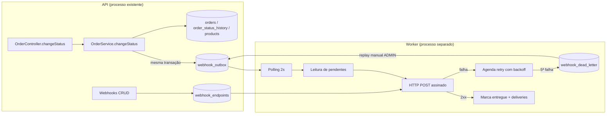

# RFC-001 - Sistema de Webhooks de Notificação de Pedidos

## Metadados

| Campo | Valor |
| --- | --- |
| Título | Sistema de Webhooks de Notificação de Pedidos |
| Autor | Helder Puia (consolidação da reunião técnica de quinta-feira) |
| Status | Em revisão |
| Data | 2026-11-07 |
| Versão | 1.0 |
| Revisores | Larissa (Tech Lead), Marcos (Product Manager), Bruno (Engenheiro Pleno, Pedidos), Diego (Engenheiro Sênior, Plataforma), Sofia (Engenheira de Segurança) |
| Documentos relacionados | [PRD](PRD.md), [FDD](FDD.md), [ADRs](adrs/README.md) |

## Resumo executivo (TL;DR)

Propomos notificar clientes B2B por webhook outbound quando o status de um pedido muda, sem tornar a mudança de status dependente da disponibilidade do cliente. A proposta é registrar o evento em uma tabela outbox no MySQL existente, dentro da mesma transação que hoje atualiza `orders`, `order_status_history` e estoque, e entregar por um worker em processo separado que faz polling a cada 2 segundos.

A entrega é at-least-once, assinada com HMAC-SHA256 por endpoint, com retry exponencial em cinco tentativas ao longo de aproximadamente 15 horas e Dead Letter Queue em tabela separada para falhas permanentes. Nenhuma infraestrutura nova é necessária: a feature reaproveita o módulo, os erros, o logger e o acesso a dados que o projeto já tem.

Estimativa de esforço: três sprints, incluindo dois dias úteis de revisão de segurança antes do deploy.

## Contexto e problema

Três clientes B2B (Atlas Comercial, MaxDistribuição e Nova Cargo) pediram formalmente notificação em tempo real de mudança de status ([09:00] Marcos). Hoje eles fazem polling em `GET /api/v1/orders` de tempos em tempos, o que torna a integração lenta e cara do lado deles. A Atlas sinalizou risco de migrar para o concorrente caso a entrega não aconteça até o fim do trimestre.

A aplicação atual não possui nenhum mecanismo de notificação externa, eventos, filas ou webhooks. O ciclo de vida do pedido é uma máquina de estados controlada (`src/modules/orders/order.status.ts`), com controle transacional de estoque e auditoria de mudança de status (`order_status_history`). É exatamente nesse ponto, o método `changeStatus` de `src/modules/orders/order.service.ts`, que a feature precisa se acoplar.

Restrições que delimitam a proposta:

- "Tempo real" para os clientes significa qualquer latência abaixo de 10 segundos ([09:02] Marcos).
- O fluxo é somente outbound, da plataforma para o cliente. Os clientes não enviam eventos ([09:02] Sofia, [09:02] Marcos).
- A mudança de status não pode ficar refém de um cliente lento ou indisponível ([09:04] Bruno).
- O time é pequeno e não deve assumir infraestrutura nova ([09:07] Diego).
- O escopo é documental nesta fase de design; nada de código de aplicação é alterado agora.

## Proposta técnica

### Visão geral

A proposta se organiza em cinco blocos.

**1. Registro transacional do evento.** O método `changeStatus` passa a chamar uma função `publishWebhookEvent(tx, order, fromStatus, toStatus)` dentro do `$transaction` já existente. A função consulta os endpoints ativos do customer que assinam o status de destino e insere uma linha em `webhook_outbox` por endpoint interessado, com o payload já renderizado e um `event_id` UUID. Se nenhum endpoint assinar o status, nada é inserido. Ver [ADR-001](adrs/ADR-001-outbox-no-mysql.md), [ADR-007](adrs/ADR-007-snapshot-do-payload-na-insercao.md) e [ADR-008](adrs/ADR-008-filtro-de-eventos-na-insercao.md).

**2. Entrega desacoplada.** Um processo separado (`npm run worker`) faz polling a cada 2 segundos, lê os eventos pendentes mais antigos em lote pequeno, envia por HTTP com timeout de 10 segundos e marca o resultado. O ordenamento é implícito por `order_id` enquanto houver worker único e nenhuma tentativa pendente para o pedido (limitação detalhada no FDD e em QA-07). Ver [ADR-002](adrs/ADR-002-worker-separado-em-polling.md).

**3. Resiliência.** Falha de entrega agenda nova tentativa com backoff de 1 minuto, 5 minutos, 30 minutos, 2 horas e 12 horas. Na quinta falha o evento vai para `webhook_dead_letter`, com payload, motivo e timestamp, e pode ser reprocessado manualmente por endpoint administrativo restrito a role ADMIN. Ver [ADR-003](adrs/ADR-003-retry-backoff-e-dlq.md).

**4. Segurança.** Cada endpoint cadastrado tem secret própria, gerada pela plataforma, usada para assinar o corpo do request com HMAC-SHA256 no header `X-Signature`. A secret é rotacionável, com a anterior válida por 24 horas em paralelo. URL obrigatoriamente `https` e payload limitado a 64KB, com erro acima disso. Ver [ADR-004](adrs/ADR-004-hmac-sha256-secret-por-endpoint.md).

**5. Contrato de entrega.** Garantia at-least-once, com `X-Event-Id` estável por evento para deduplicação no cliente, além de `X-Signature`, `X-Timestamp` e `X-Webhook-Id`. O corpo é um JSON enxuto com identificação do evento, do pedido, do customer e da transição de status, sem itens do pedido. Ver [ADR-005](adrs/ADR-005-at-least-once-com-x-event-id.md).

### Superfície pública

A feature expõe CRUD de configuração de webhooks, consulta de histórico de entregas, rotação de secret e um endpoint administrativo de replay de DLQ. Todos autenticados com o JWT existente; apenas o replay exige role ADMIN. O detalhamento de rotas, payloads e códigos de erro está no [FDD](FDD.md), seção "Contratos públicos", e não é repetido aqui.

### Estrutura no código

Módulo novo, a criar, em `src/modules/webhooks`, seguindo a divisão controller, service, repository, routes e schemas dos módulos existentes, mais o processador e o entry-point `src/worker.ts`. Erros novos estendem as classes de `src/shared/errors/http-errors.ts` com prefixo `WEBHOOK_`. Logger, middleware de erro, schemas Zod e `requireRole` são reaproveitados sem alteração. Ver [ADR-006](adrs/ADR-006-reuso-dos-padroes-existentes.md).

## Alternativas consideradas

| # | Alternativa | Por que foi descartada | Trade-off aceito |
| --- | --- | --- | --- |
| RFC-ALT-01 | Disparo síncrono de HTTP dentro de `changeStatus` | Cliente lento travaria a mudança de status de outros pedidos; não há rollback razoável se o cliente estiver fora do ar ([09:04] Bruno, [09:06] Diego) | Abrimos mão da entrega imediata em troca de desacoplamento e de uma transação previsível |
| RFC-ALT-02 | Redis Streams ou broker de fila dedicado | Exigiria subir e operar infraestrutura nova para um time pequeno, classificado como overengineering ([09:07] Larissa, [09:07] Diego) | Abrimos mão de reatividade quase instantânea e de um broker maduro em troca de zero infraestrutura adicional |
| RFC-ALT-03 | Trigger de banco para notificar o worker | MySQL não notifica processo externo; a saída seria improvisar arquivo ou endpoint ([09:09] Diego) | Abrimos mão de reação no instante do commit em troca de simplicidade e de latência de 2 segundos, dentro do teto de 10 segundos |
| RFC-ALT-04 | Retry indefinido com backoff | Evento de cliente que sumiu ficaria pendurado para sempre, sem estado final ([09:15] Diego) | Abrimos mão da garantia de tentar para sempre em troca de um estado final determinístico (DLQ) |
| RFC-ALT-05 | Secret global da plataforma em vez de secret por endpoint | Vazamento de uma secret comprometeria todos os clientes ([09:21] Sofia) | Abrimos mão da operação mais simples em troca de isolamento por cliente |
| RFC-ALT-06 | Exactly-once | Exigiria coordenação entre as duas pontas, com complexidade desproporcional ([09:25] Diego) | Transferimos a deduplicação para o cliente em troca de um worker simples e resiliente |

As alternativas de maior impacto estão registradas como ADRs, com contexto e consequências completos.

## Questões em aberto

| # | Questão | Situação na reunião | Impacto se não decidida |
| --- | --- | --- | --- |
| RFC-QA-01 | Rate limiting de envio por cliente | Levantada por Diego e deixada como "observar e decidir depois" ([09:38] Diego, [09:39] Larissa) | Cliente com muitos pedidos mudando em sequência pode receber uma rajada de chamadas. Precisa de medição antes de decidir |
| RFC-QA-02 | Notificação proativa de falha ao cliente (e-mail) | Explicitamente adiada para a próxima fase ([09:37] Marcos, [09:37] Larissa) | Cliente só descobre falha se consultar o histórico de entregas ou se notar ausência de evento |
| RFC-QA-03 | Garantia de ordenação global e escala para múltiplos workers | Adiada: ordenamento só é garantido por `order_id` e com worker único. Particionamento ou lock pessimista ficaram como problema futuro ([09:12] Diego, [09:13] Larissa) | Escalar horizontalmente o worker quebra a ordem de entrega por pedido até que o particionamento seja implementado |
| RFC-QA-04 | Arquivamento de eventos entregues | Colocado fora do escopo desta feature ([09:08] Diego) | Crescimento indefinido de `webhook_outbox` e degradação gradual da leitura |
| RFC-QA-05 | Endurecimento de autorização do CRUD de configuração | Discussão indicou "por enquanto" qualquer role autenticada, com endurecimento futuro ([09:36] Marcos, [09:37] Sofia) | Qualquer usuário autenticado pode criar, editar e remover webhook de qualquer customer |
| RFC-QA-06 | Prazo compatível com a expectativa comercial | Cliente pediu fim de novembro, estimativa técnica foi de três sprints ([09:45] Marcos, [09:46] Larissa) | Risco comercial com a Atlas caso o prazo não seja renegociado |
| RFC-QA-07 | Ordenação por pedido quando existe retry pendente | A reunião tratou o ordenamento como implícito por worker único ([09:12] Diego, [09:13] Larissa), sem confrontar com a política de retry. Bloquear a fila por `order_id` (head-of-line) não foi discutido | Cliente pode receber a transição seguinte antes da retentativa da transição anterior do mesmo pedido |

## Impacto e riscos

**Impacto no código existente.** A mudança de maior risco é dentro de `OrderService.changeStatus`, que passa a executar uma consulta de configuração e uma escrita adicional na mesma transação. Qualquer aumento relevante de latência nesse caminho afeta a operação de pedidos como um todo, não apenas a feature. O módulo de webhooks entra como mais um controller em `buildControllers` (`src/app.ts`) e como mais um router em `src/routes/index.ts`, sem alterar contratos existentes.

**Impacto operacional.** Passa a existir um segundo processo para deploy e monitoramento. Sem monitoramento, falhas permanentes ficam silenciosas até alguém consultar a DLQ.

**Impacto em dados.** Quatro tabelas novas (`webhook_endpoints`, `webhook_outbox`, `webhook_dead_letter` e `webhook_deliveries`, esta última para o histórico de entregas), todas no mesmo banco, adicionadas por migration. Não há backfill: a feature começa a valer a partir do deploy.

**Riscos principais.**

| # | Risco | Probabilidade | Impacto | Mitigação proposta |
| --- | --- | --- | --- | --- |
| RFC-RISK-01 | Latência da mudança de status degradar por causa da escrita na outbox | Média | Alto | Manter a inserção enxuta, indexar a tabela por status e `created_at`, medir latência de `changeStatus` antes e depois |
| RFC-RISK-02 | Worker parado passar despercebido e a fila crescer | Média | Alto | Healthcheck e métrica de idade do evento mais antigo pendente, além de alerta de fila acima de limite |
| RFC-RISK-03 | Secret vazar em log da plataforma ou do cliente | Baixa | Alto | Redação do campo no logger, devolver a secret apenas na criação e na rotação, documentar cuidado no portal do desenvolvedor |
| RFC-RISK-04 | Estimativa de três sprints não caber no prazo comercial | Alta | Alto | Renegociar prazo com a Atlas com base no escopo mínimo (CRUD + entrega com retry) versus itens adiados |

## Decisões relacionadas

- [ADR-001 - Padrão Outbox em tabela MySQL](adrs/ADR-001-outbox-no-mysql.md)
- [ADR-002 - Worker em processo separado com polling de 2 segundos](adrs/ADR-002-worker-separado-em-polling.md)
- [ADR-003 - Retry com backoff exponencial e DLQ em tabela separada](adrs/ADR-003-retry-backoff-e-dlq.md)
- [ADR-004 - Autenticação HMAC-SHA256 com secret por endpoint](adrs/ADR-004-hmac-sha256-secret-por-endpoint.md)
- [ADR-005 - Garantia at-least-once com deduplicação por X-Event-Id](adrs/ADR-005-at-least-once-com-x-event-id.md)
- [ADR-006 - Reuso máximo dos padrões existentes do projeto](adrs/ADR-006-reuso-dos-padroes-existentes.md)
- [ADR-007 - Snapshot do payload renderizado na inserção da outbox](adrs/ADR-007-snapshot-do-payload-na-insercao.md)
- [ADR-008 - Filtro de eventos na inserção da outbox](adrs/ADR-008-filtro-de-eventos-na-insercao.md)

## Próximos passos

1. Revisão deste RFC por Larissa, Bruno, Diego e Sofia, com foco em QA-01, QA-03 e QA-06.
2. Detalhamento de implementação já disponível no [FDD](FDD.md) para estimativa fina por sprint.
3. Sessão de revisão de segurança com Sofia antes do deploy, com pelo menos dois dias úteis reservados ([09:46] Sofia).
